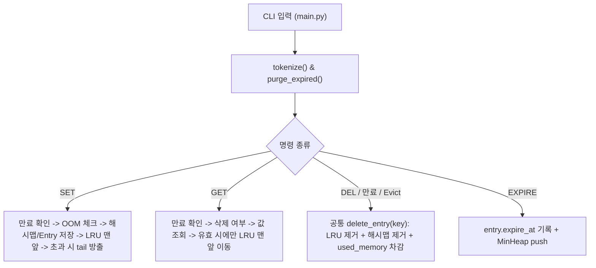

# 미션 B5-1 개념 가이드 (기초 → 상세 → 쉬운 설명)

## 0. 한눈에 보는 개념 순서 리스트
1. 메모리 / 배열(고정 길이 칸) / 포인터(주소로 가리키기)
2. 시간 복잡도 Big-O (`O(1)`, `O(log n)`, `O(n)`)
3. 이중 연결 리스트 (`doubly_linked_list.py`)
4. 해시 함수 → 해시맵 → 충돌 → 체이닝 → 로드 팩터와 리사이즈 (`hashmap.py`)
5. 완전 이진 트리 → 최소 힙 (`min_heap.py`)
6. 캐시와 LRU (`memory.py`)
7. TTL(만료)과 Lazy Deletion (`ttl.py`)
8. 에러 처리와 REPL (`errors.py`, `main.py`)
9. 전체 상태 조율 (`mini_redis.py`, `string_commands.py`)

---

## 1. 메모리 · 배열 · 포인터
- **상세**: 배열은 같은 크기 칸이 연속으로 붙어 있어 `a[i]`로 번호만 알면 즉시 접근(`O(1)`)합니다. 포인터(참조)는 "다른 객체가 있는 주소"를 들고 있는 값입니다.
- **쉬운 설명**: 배열은 **번호 붙은 사물함**, 포인터는 **"○○ 사물함에 있어요"라고 적힌 쪽지**.

## 2. 시간 복잡도 Big-O
- **상세**: 데이터 개수 `n`이 늘어나도 작업 시간이 일정하면 `O(1)`, 절반씩 좁혀 가며 찾으면 `O(log n)`, 처음부터 끝까지 다 확인해야 하면 `O(n)`입니다.
- **쉬운 설명**: 친구 집 찾기. `O(1)`=주소를 이미 알아 바로 방문, `O(n)`=동네 모든 집을 하나씩 확인.

## 3. 이중 연결 리스트 (`doubly_linked_list.py`)
- **상세**: 노드마다 `prev`, `next`, `data`를 가집니다. 노드 참조만 알고 있으면 양옆 노드의 포인터 2~4개만 바꿔 삽입·삭제·이동이 **`O(1)`** 입니다.
- **쉬운 설명**: **양손을 잡고 선 줄**. 가운데 철수가 빠져도 앞뒤 친구가 손만 다시 잡으면 끝입니다.

## 4. 해시맵 (`hashmap.py`)
- **해시 함수**: `djb2` 알고리즘(`h = 5381`, 매 UTF-8 바이트마다 `h = (h * 33 + b) & 0xFFFFFFFF`).
- **버킷 인덱스**: `해시값 % 버킷수`.
- **충돌 해결(체이닝)**: 버킷마다 `DoublyLinkedList`를 두어 같은 칸에 걸린 `[key, value]`들을 줄 세워 저장.
- **로드 팩터 & 리사이즈**: `항목수 / 버킷수 > 0.75`이면 버킷을 **2배**로 늘리고 **전원 재해싱(Rehash)** 합니다. (나누는 수가 바뀌므로 인덱스도 반드시 재계산!)
- **쉬운 설명**: **아파트 우편함**. 너무 붐비면 우편함 동을 2배 증축하고 모든 편지를 새 호수에 맞춰 다시 꽂습니다.

## 5. 최소 힙 (`min_heap.py`)
- **완전 이진 트리 배열**: 부모 `(i-1)//2`, 왼쪽 자식 `2i+1`, 오른쪽 자식 `2i+2`.
- **성질**: 항상 부모 ≤ 자식 → 루트(`_a[0]`)가 최솟값(가장 빠른 만료 시각).
- `peek()` `O(1)`, `push()`/`pop()` `O(log n)`.
- **쉬운 설명**: **유통기한 임박순 냉장고**. 맨 위 음식만 보면 가장 먼저 버릴 것을 즉시 압니다.

## 6. 캐시와 LRU (`memory.py`)
- **LRU(Least Recently Used)**: 가장 오래 사용하지 않은 키(`tail`)부터 제거.
- **`O(1)` LRU 원리**: 해시맵이 `Entry(value, lru_node, expire_at)`를 저장 → 키로 `Entry` 조회(`O(1)`) → `entry.lru_node`를 리스트 맨 앞(`head`)으로 이동(`O(1)`).
- **`used_memory` 규칙**: `Σ(len(utf8(key)) + len(utf8(value)))`.

## 7. TTL과 Lazy Deletion (`ttl.py`)
- **TTL**: 남은 수명 조회(없는 키 `-2`, 만료 미설정 `-1`, 설정됨 남은 초). `EXPIRE key 0` 이하는 즉시 삭제.
- **Lazy Deletion**: `DEL`이나 `SET` 덮어쓰기로 낡은 힙 항목을 굳이 찾아 지우지 않고, 힙에서 꺼낼 때 해시맵의 현재 `Entry.expire_at`과 일치할 때만 진짜 삭제합니다.

## 8. 전체 조립: 세 자료구조의 상태 일관성 (`mini_redis.py`)

---

## 9. 3초 복습 퀴즈
1. **Q.** 이중 연결 리스트에서 중간 노드 삭제가 `O(1)`인 이유는?  
   **A.** `Node`가 `prev`와 `next`를 모두 알고 있고 `Entry`가 `Node` 주소를 쥐고 있어 양옆 포인터만 바꾸면 되기 때문입니다.
2. **Q.** 로드 팩터 `0.75` 초과 시 버킷만 늘리고 데이터를 안 옮기면 어떻게 될까요?  
   **A.** `% 버킷수` 결과가 달라져서 기존 키를 조회할 때 엉뚱한 버킷을 찾게 됩니다. 반드시 전원 재해싱(Rehash)해야 합니다.
3. **Q.** `GET` 실행 시 만료된 키라면 LRU는 어떻게 되나요?  
   **A.** 즉시 `delete_entry`로 삭제하고 `(nil)`을 반환하며, **LRU 갱신은 하지 않습니다.**
